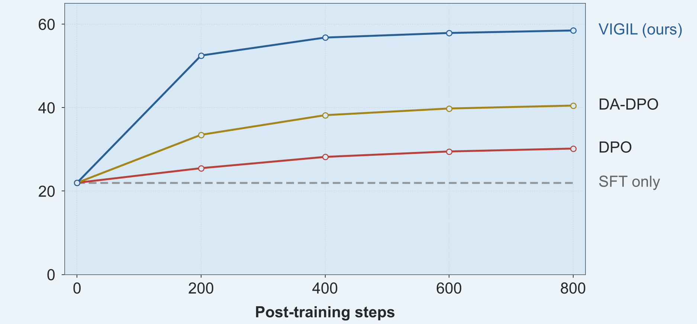

# Plotting resources

Reusable scientific plotting templates, a complete style guide, and reproducible examples.
The selected style uses **Arial 10 pt**, bold figure/panel/axis titles, **8 pt source and notes**, the R1 cobalt/brick/gold palette, plot background **#D8E8F4**, and figure background **#EDF4F9**. Legends sit below plots. Complete figures default to **6.75 inches**, matching the article text column.

- [Style guide](docs/style-guide.md): exact colors, typography, marks, dimensions and spacing.
- [Editable starters](templates/README.md): nine scripts for common plot types; replace data and captions.
- [Setup](docs/setup.md) and [adopted decisions](docs/decisions.md).
- [Reference gallery](examples/reference_gallery/README.md): all 16 reviewed figures and lorem ipsum article proofs.
- [Design history](studies/README.md): research, earlier studies and decision records.



## Start a plot

Install Arial Regular, Bold and Italic on the rendering machine, then:

```sh
python -m venv .venv
source .venv/bin/activate
python -m pip install -e '.[examples]'
python templates/line_plot.py
python templates/line_plot.py --minimal
```

Outputs are PDF, PNG and SVG in `build/templates/`. Minimal output goes in `build/templates/minimal/`: white figure and plot backgrounds, no figure title, subtitle, source or notes. Axis/panel labels, legends, typography and data colors remain.

For direct use:

```python
import plotting_resources as plots

fig, axes = plots.figure()
ax = axes[0, 0]
plots.line(ax, [1, 2, 3], [4, 7, 6], 'Observed')
ax.set(xlabel='Step', ylabel='Response')
plots.export(fig, 'build/my-plot', title='An example',
             source='Source: Illustrative values.', notes='Notes: Replace with your data.')
# Add minimal=True to export a caption-free figure on white.
```

## Rebuild the collections

```sh
python -m unittest discover -s tests
python templates/render_all.py
python examples/reference_gallery/render.py
python templates/render_all.py --minimal
python examples/reference_gallery/render.py --minimal
```

The reference runner regenerates original source data at native scale, with font, bounds, overlap and data checks. Figures 11, 12 and 16 use text width. The three dense retained exceptions use an explicitly documented wider layout. No saved export is needed to rebuild the current gallery.

## Repository layout

```text
src/plotting_resources/       Shared theme, chart helpers, measured layout/export, selected_style.json
templates/                   Nine editable starters and the collection runner
examples/reference_gallery/  Reproducible retained-figure renderers
examples/data/               Reference inputs and provenance
docs/                        Style guide, decisions, setup and curated previews
studies/                     Historical research, scripts and small decision records
third_party/                 Attributed upstream code and applicable licenses
tests/                       Data, layout and rendering-mode checks
build/                       Ignored generated figures, review books and local history
```

Generated exports and environments are excluded from Git. Historical local exports are preserved in `build/legacy/`; source, data and decision records are versioned. See [upstream provenance](third_party/README.md): the root MIT license does not replace the licenses attached to upstream examples or data.
